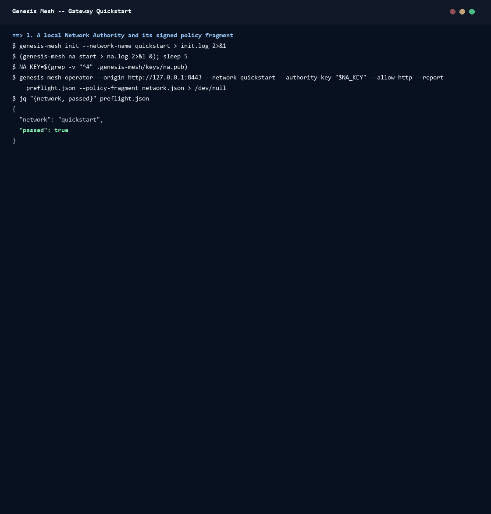

# Quickstart: a production-mode gateway

This walkthrough runs a gateway in production mode in front of a local
Network Authority, on one Linux machine. It covers the steps every
deployment repeats: preflight the authority, write a policy with one client,
check it, initialize durable state, start the gateway, and verify a real
certificate before and after its revocation.



The recording is a real run of [`assets/quickstart/record.sh`](assets/quickstart/record.sh);
its transcript is [`session.txt`](assets/quickstart/session.txt).

## Before you start

- `genesis-mesh-gateway` and `genesis-mesh-operator`: from a release ZIP (see
  [distribution](distribution.md)), or built from this repository with
  `cargo build --locked --release --bin genesis-mesh-gateway --bin genesis-mesh-operator`.
- The core's Python package for the authority and the node:
  `pip install genesis-mesh` (Python 3.12 or newer).
- `jq`, `openssl` and `curl`. Ports 8443 and 8080 free.

Work in an empty directory. Everything below is local and uses plain HTTP;
a real deployment pins an HTTPS authority and runs behind a TLS ingress (see
[operations](operations.md#deployment-boundary)).

## 1. Preflight the authority

Create a local authority for a network called `quickstart` and start it in
the background:

```sh
genesis-mesh init --network-name quickstart > init.log 2>&1
(genesis-mesh na start > na.log 2>&1 &); sleep 5
```

Pin its public key, then let `genesis-mesh-operator` check the authority and
write the network's policy fragment. Here the key comes from the file `init`
wrote; for another operator's authority, confirm it through an independent
channel (see [federation](federation.md#onboard-an-authority)).

```sh
NA_KEY=$(grep -v "^#" .genesis-mesh/keys/na.pub)
genesis-mesh-operator --origin http://127.0.0.1:8443 --network quickstart \
  --authority-key "$NA_KEY" --allow-http \
  --report preflight.json --policy-fragment network.json > /dev/null
jq "{network, passed}" preflight.json
```

`passed` must be `true`. A failed check writes no fragment. The fragment
holds the pinned key under `anchors`, the authority's current signed CRL,
its `crl_url` and its `authority_url`.

## 2. Write the policy

Give the gateway one client. The policy stores only the SHA-256 of the
client's token; keep the token itself in the caller's secret store.

```sh
TOKEN=$(openssl rand -hex 32)
DIGEST=$(printf %s "$TOKEN" | sha256sum | cut -d" " -f1)
jq --arg d "$DIGEST" '{revision: "quickstart-1",
  clients: [{id: "quickstart-client", token_sha256: $d, networks: ["quickstart"],
             metrics: true, requests_per_minute: 120}],
  networks: .}' network.json > policy.json
```

The client can verify certificates of `quickstart` and read `/metrics`. To
let it call authority operations too, add `service_groups` (see
[authority services](services.md#operator-configuration)). The policy format
is in [operations](operations.md#policy-format).

## 3. Check, initialize, start

```sh
export GATEWAY_POLICY_FILE=$PWD/policy.json
genesis-mesh-gateway --check-config
export GATEWAY_STATE_FILE=$PWD/state.db
genesis-mesh-gateway --init-state
(genesis-mesh-gateway > gateway.log 2>&1 &); sleep 2
curl -s http://127.0.0.1:8080/ready
```

`--check-config` checks the policy and the CRL's signature without opening a
listener. Run it before `GATEWAY_STATE_FILE` is set, or against a stopped
replica: with durable state it needs the database to itself. `--init-state`
creates the state file once and refuses to overwrite one. `/ready` answers
`{"status":"ready"}` once every network has a fresh CRL. Every setting is in
the [configuration reference](configuration.md).

## 4. Verify a certificate

Enroll a node with the authority, then send its join certificate to the
gateway:

```sh
INVITE=$(genesis-mesh admin invite --role role:client)
genesis-mesh join --na http://127.0.0.1:8443 --token "$INVITE"
CERT_ID=$(jq -r .cert_id .genesis-mesh/node.cert.json)
AUTH="Authorization: Bearer $TOKEN"
jq "{certificate: .}" .genesis-mesh/node.cert.json > verify.json
curl -s -H "$AUTH" --json @verify.json http://127.0.0.1:8080/verify
```

The answer is `{"trusted":true,"reasons":[]}`. Always check `trusted`: a
`200` alone grants nothing.

## 5. Revoke it

Revoke the certificate at the authority. The gateway reads the authority's
CRL every minute, so within a minute the new sequence appears in
`/v1/networks` and the same request is refused:

```sh
genesis-mesh admin revoke "$CERT_ID" --reason cessation_of_operation > revoke.log
until curl -s -H "$AUTH" http://127.0.0.1:8080/v1/networks \
  | jq -e ".networks[0].revocation.revoked_count == 1" > /dev/null; do sleep 5; done
curl -s -H "$AUTH" --json @verify.json http://127.0.0.1:8080/verify
```

The answer is `{"trusted":false,"reasons":["Revoked { reason: \"cessation_of_operation\" }"]}`.

Stop the two background processes when you are done
(`pkill -f genesis-mesh-gateway; pkill -f "genesis-mesh na start"`).

## Next

- Run the released image instead: [distribution](distribution.md).
- Durable state, audit delivery, OIDC, mutual TLS and shared quotas:
  [platform controls](platform.md).
- Development mode (`GATEWAY_DEVELOPMENT=true`) has `/keygen` and `/issue`
  for local experiments; `smoke.sh` checks such a gateway end to end. Never
  use it for a public service.

## Rebuild the recording

On Linux, in an empty directory, with the tools above on `PATH`:

```sh
bash /path/to/gateway/docs/assets/quickstart/record.sh
python /path/to/gateway/docs/assets/render_terminal_gif.py session.txt quickstart.gif \
  --title "Genesis Mesh -- Gateway Quickstart"
```

The renderer needs Pillow (`pip install pillow`).
